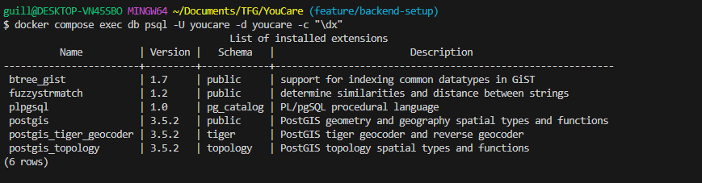
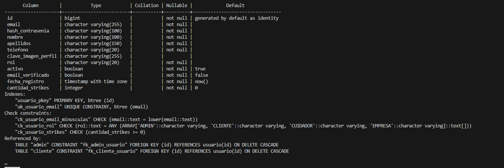
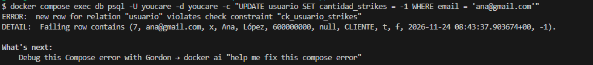
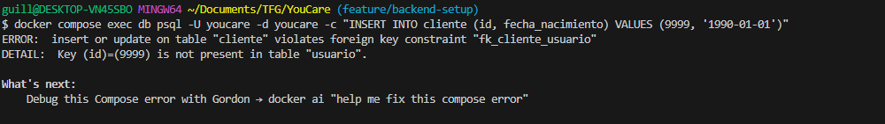

# Comprobaciones de la base de datos — YouCare

Comandos para comprobar desde la terminal que la BD local está como esperamos.
Se ejecutan desde la **raíz del repo** (excepto el arranque de la app, que se lanza desde `backend/`).

**Requisito:** Docker Desktop abierto, con *Engine running*.

> Si `psql` muestra `~` o `(END)` al final, es el paginador: pulsa `q` para salir.

---

## 1. Levantar la BD desde cero

```bash
docker compose down -v
docker compose up -d
docker compose ps
```

**Esperado:** `youcare-db` y `youcare-mailpit` en estado `running` (la BD, además, `healthy`).

⚠️ `down -v` borra todos los datos locales. Al arrancar, Flyway reconstruye la BD desde V1.


---

## 2. Arrancar la app

```bash
cd backend
./mvnw spring-boot:run
```

**Esperado en el log:**
- `Successfully applied 7 migrations to schema "public", now at version v8`
- `Started BackendApplication`

(Son 7 porque no existe V5: Flyway admite huecos en la numeración.)

Si aparece `Application run failed`, el motivo está en `Message:` o en `Description:`. Con `ddl-auto=validate`, si una entidad no coincide con su tabla sale `missing column` o `wrong column type`.


---

## 3. Migraciones aplicadas por Flyway

En otra terminal, desde la raíz:

```bash
docker compose exec db psql -U youcare -d youcare -c "SELECT version, description, success FROM flyway_schema_history ORDER BY installed_rank"
```

**Esperado:** V1, V2, V3, V4, V6, V7 y V8, todas con `success = t`.


---

## 4. Extensiones

```bash
docker compose exec db psql -U youcare -d youcare -c "\dx"
```

**Esperado:** `postgis` y `btree_gist` en la lista.



---

## 5. Tablas

### 5.1 Listado

```bash
docker compose exec db psql -U youcare -d youcare -c "\dt"
```

**Esperado:** `usuario`, `cliente`, `admin`, `empresa`, `empresa_documento`, `cuidador`, `cuidador_documento`, `cuidador_franja_horaria`, `persona_cuidada`, `flyway_schema_history` y `spatial_ref_sys` (esta última la crea PostGIS).


### 5.2 `usuario`

```bash
docker compose exec db psql -U youcare -d youcare -c "\d usuario"
```

**Esperado:**
- `telefono` y `cantidad_strikes` con `not null`; `cantidad_strikes` con default `0`.
- Restricciones `uk_usuario_email`, `ck_usuario_email_minusculas`, `ck_usuario_rol` y `ck_usuario_strikes`.
- Referenciada por `fk_admin_usuario`, `fk_cliente_usuario`, `fk_empresa_usuario` y `fk_cuidador_usuario`, con `ON DELETE CASCADE`.



### 5.3 `cliente`

```bash
docker compose exec db psql -U youcare -d youcare -c "\d cliente"
```

**Esperado:**
- `id` es la PK.
- `fecha_nacimiento` con `not null`.
- `direccion varchar(200)` y `ciudad varchar(100)`.
- FK `fk_cliente_usuario`.
- Referenciada por `fk_persona_cuidada_cliente`.


### 5.4 `admin`

```bash
docker compose exec db psql -U youcare -d youcare -c "\d admin"
```

**Esperado:** `id` es la PK, `departamento varchar(100)` y FK `fk_admin_usuario`.


---

## 6. Las restricciones funcionan

Cada prueba intenta insertar un dato inválido. **El error es el resultado esperado.**

### 6.1 Email en mayúsculas → rechazado

```bash
docker compose exec db psql -U youcare -d youcare -c "INSERT INTO usuario (email, hash_contrasenia, nombre, apellidos, telefono, rol) VALUES ('Ana@gmail.com', 'x', 'Ana', 'López', '600000000', 'CLIENTE')"
```

**Esperado:** `violates check constraint "ck_usuario_email_minusculas"`


### 6.2 Email correcto → se inserta

```bash
docker compose exec db psql -U youcare -d youcare -c "INSERT INTO usuario (email, hash_contrasenia, nombre, apellidos, telefono, rol) VALUES ('ana@gmail.com', 'x', 'Ana', 'López', '600000000', 'CLIENTE')"
```

**Esperado:** `INSERT 0 1`


### 6.3 Email duplicado → rechazado

Repite el comando del 6.2.

**Esperado:** `violates unique constraint "uk_usuario_email"`


### 6.4 Rol inválido → rechazado

```bash
docker compose exec db psql -U youcare -d youcare -c "INSERT INTO usuario (email, hash_contrasenia, nombre, apellidos, telefono, rol) VALUES ('rol@gmail.com', 'x', 'Rol', 'Malo', '600000001', 'SUPERUSER')"
```

**Esperado:** `violates check constraint "ck_usuario_rol"`


### 6.5 Strikes negativos → rechazado

```bash
docker compose exec db psql -U youcare -d youcare -c "UPDATE usuario SET cantidad_strikes = -1 WHERE email = 'ana@gmail.com'"
```

**Esperado:** `violates check constraint "ck_usuario_strikes"`



### 6.6 Teléfono vacío → rechazado

```bash
docker compose exec db psql -U youcare -d youcare -c "INSERT INTO usuario (email, hash_contrasenia, nombre, apellidos, rol) VALUES ('sintel@gmail.com', 'x', 'Sin', 'Teléfono', 'CLIENTE')"
```

**Esperado:** `null value in column "telefono" ... violates not-null constraint`


### 6.7 Cliente sin usuario → rechazado

```bash
docker compose exec db psql -U youcare -d youcare -c "INSERT INTO cliente (id, fecha_nacimiento) VALUES (9999, '1990-01-01')"
```

**Esperado:** `violates foreign key constraint "fk_cliente_usuario"`



### 6.8 Borrado en cascada

Crear la fila de `cliente` para Ana:

```bash
docker compose exec db psql -U youcare -d youcare -c "INSERT INTO cliente (id, fecha_nacimiento) SELECT id, '1990-01-01' FROM usuario WHERE email = 'ana@gmail.com'"
docker compose exec db psql -U youcare -d youcare -c "SELECT u.id, u.email, c.fecha_nacimiento FROM usuario u JOIN cliente c ON c.id = u.id"
```

Borrar el usuario y comprobar que su fila de `cliente` también desaparece:

```bash
docker compose exec db psql -U youcare -d youcare -c "DELETE FROM usuario WHERE email = 'ana@gmail.com'"
docker compose exec db psql -U youcare -d youcare -c "SELECT count(*) FROM cliente"
```

**Esperado:** antes del borrado, una fila con Ana y su fecha de nacimiento; después, `count = 0`.


---

## 7. V6 — Empresa

### 7.1 Estructura de `empresa`

```bash
docker compose exec db psql -U youcare -d youcare -c "\d empresa"
```

**Esperado:**
- `razon_social varchar(150)`, `cif varchar(9)` y `estado_verificacion varchar(20)`, todas `not null`.
- `estado_verificacion` con default `'SIN_SUBIR'`.
- Restricciones `uk_empresa_cif`, `ck_empresa_cif` y `ck_empresa_estado_verificacion`.
- FK `fk_empresa_usuario` (`ON DELETE CASCADE`).
- Referenciada por `fk_cuidador_empresa` y `fk_empresa_documento_empresa`.


### 7.2 Estructura de `empresa_documento`

```bash
docker compose exec db psql -U youcare -d youcare -c "\d empresa_documento"
```

**Esperado:**
- `estado` con default `'PENDIENTE'` y `fecha_subida` con default `now()`.
- `motivo_rechazo` es la única columna que admite `null`.
- Restricciones `ck_empresa_documento_tipo`, `ck_empresa_documento_estado` y `ck_empresa_documento_motivo`.
- FK `fk_empresa_documento_empresa` (`ON DELETE CASCADE`).


### 7.3 Empresa correcta → se inserta

Primero el usuario con rol `EMPRESA` y después su fila en `empresa`:

```bash
docker compose exec db psql -U youcare -d youcare -c "INSERT INTO usuario (email, hash_contrasenia, nombre, apellidos, telefono, rol) VALUES ('empresa@gmail.com', 'x', 'Ana', 'López', '600000010', 'EMPRESA')"
docker compose exec db psql -U youcare -d youcare -c "INSERT INTO empresa (id, razon_social, cif) SELECT id, 'Cuidados Sur SL', 'B12345678' FROM usuario WHERE email = 'empresa@gmail.com'"
docker compose exec db psql -U youcare -d youcare -c "SELECT u.email, e.razon_social, e.cif, e.estado_verificacion FROM usuario u JOIN empresa e ON e.id = u.id"
```

**Esperado:** `INSERT 0 1` dos veces, y una fila con `estado_verificacion = SIN_SUBIR` (lo pone el `DEFAULT`).


### 7.4 CIF con formato inválido → rechazado

```bash
docker compose exec db psql -U youcare -d youcare -c "UPDATE empresa SET cif = '12345678Z' WHERE cif = 'B12345678'"
```

**Esperado:** `violates check constraint "ck_empresa_cif"`


### 7.5 CIF duplicado → rechazado

Intenta crear otra empresa con el mismo CIF. Va en una sola sentencia, así que al fallar no queda ningún usuario suelto:

```bash
docker compose exec db psql -U youcare -d youcare -c "WITH u AS (INSERT INTO usuario (email, hash_contrasenia, nombre, apellidos, telefono, rol) VALUES ('empresa2@gmail.com', 'x', 'Eva', 'Gil', '600000011', 'EMPRESA') RETURNING id) INSERT INTO empresa (id, razon_social, cif) SELECT id, 'Otra SL', 'B12345678' FROM u"
```

**Esperado:** `violates unique constraint "uk_empresa_cif"`


### 7.6 Estado de verificación inválido → rechazado

```bash
docker compose exec db psql -U youcare -d youcare -c "UPDATE empresa SET estado_verificacion = 'INVENTADO' WHERE cif = 'B12345678'"
```

**Esperado:** `violates check constraint "ck_empresa_estado_verificacion"`


### 7.7 Documento de la empresa

Subir el CIF y comprobar que queda `PENDIENTE`:

```bash
docker compose exec db psql -U youcare -d youcare -c "INSERT INTO empresa_documento (empresa_id, tipo, clave_archivo) SELECT id, 'CIF', 'docs/cif.pdf' FROM usuario WHERE email = 'empresa@gmail.com'"
docker compose exec db psql -U youcare -d youcare -c "SELECT u.email, d.tipo, d.estado, d.clave_archivo FROM empresa_documento d JOIN usuario u ON u.id = d.empresa_id"
```

**Esperado:** `INSERT 0 1` y una fila con `tipo = CIF` y `estado = PENDIENTE`.

Rechazarlo **sin motivo** no debe dejar:

```bash
docker compose exec db psql -U youcare -d youcare -c "UPDATE empresa_documento SET estado = 'RECHAZADO' WHERE tipo = 'CIF'"
```

**Esperado:** `violates check constraint "ck_empresa_documento_motivo"`


---

## 8. V7 — Cuidador

Usa la empresa que creaste en el apartado 7.

### 8.1 Estructura de `cuidador`

```bash
docker compose exec db psql -U youcare -d youcare -c "\d cuidador"
```

**Esperado:**
- `dni_nie varchar(9)` con `not null`; `empresa_id` y `estado_en_empresa` admiten `null`.
- `estado_verificacion` con default `'SIN_SUBIR'`.
- Restricciones `uk_cuidador_dni_nie`, `ck_cuidador_dni_nie`, `ck_cuidador_estado_verificacion`, `ck_cuidador_estado_en_empresa` y `ck_cuidador_empresa_y_estado`.
- FK `fk_cuidador_usuario` (`ON DELETE CASCADE`) y `fk_cuidador_empresa` (**sin** `ON DELETE`).
- Referenciada por `cuidador_documento` y `cuidador_franja_horaria`.


### 8.2 Estructura de las tablas de colección

```bash
docker compose exec db psql -U youcare -d youcare -c "\d cuidador_documento"
docker compose exec db psql -U youcare -d youcare -c "\d cuidador_franja_horaria"
```

**Esperado:**
- `cuidador_documento`: mismas columnas y restricciones que `empresa_documento` (con `ck_cuidador_documento_*`), FK `ON DELETE CASCADE`.
- `cuidador_franja_horaria`: `dia_semana varchar(10)`, `hora_inicio` y `hora_fin` de tipo `time`, y restricciones `ck_cuidador_franja_dia` y `ck_cuidador_franja_horas`.


### 8.3 Cuidador autónomo → se inserta

```bash
docker compose exec db psql -U youcare -d youcare -c "INSERT INTO usuario (email, hash_contrasenia, nombre, apellidos, telefono, rol) VALUES ('luis@gmail.com', 'x', 'Luis', 'Pérez', '600000020', 'CUIDADOR')"
docker compose exec db psql -U youcare -d youcare -c "INSERT INTO cuidador (id, dni_nie) SELECT id, '12345678Z' FROM usuario WHERE email = 'luis@gmail.com'"
```

**Esperado:** `INSERT 0 1` dos veces. Sin empresa ni estado en empresa.

### 8.4 Cuidador dentro de una empresa → se inserta

```bash
docker compose exec db psql -U youcare -d youcare -c "INSERT INTO usuario (email, hash_contrasenia, nombre, apellidos, telefono, rol) VALUES ('marta@gmail.com', 'x', 'Marta', 'Ruiz', '600000021', 'CUIDADOR')"
docker compose exec db psql -U youcare -d youcare -c "INSERT INTO cuidador (id, dni_nie, empresa_id, estado_en_empresa) SELECT u.id, '87654321X', (SELECT id FROM empresa LIMIT 1), 'PENDIENTE' FROM usuario u WHERE u.email = 'marta@gmail.com'"
docker compose exec db psql -U youcare -d youcare -c "SELECT u.email, c.dni_nie, c.estado_verificacion, c.empresa_id IS NOT NULL AS tiene_empresa, c.estado_en_empresa FROM cuidador c JOIN usuario u ON u.id = c.id ORDER BY u.email"
```

**Esperado:** dos filas, ambas con `estado_verificacion = SIN_SUBIR`:
- `luis@gmail.com`: `tiene_empresa = f` y `estado_en_empresa` vacío.
- `marta@gmail.com`: `tiene_empresa = t` y `estado_en_empresa = PENDIENTE`.


### 8.5 Estado en empresa sin empresa → rechazado

```bash
docker compose exec db psql -U youcare -d youcare -c "UPDATE cuidador SET estado_en_empresa = 'ACTIVO' WHERE dni_nie = '12345678Z'"
```

**Esperado:** `violates check constraint "ck_cuidador_empresa_y_estado"`

### 8.6 Empresa sin estado en empresa → rechazado

```bash
docker compose exec db psql -U youcare -d youcare -c "UPDATE cuidador SET estado_en_empresa = NULL WHERE dni_nie = '87654321X'"
```

**Esperado:** `violates check constraint "ck_cuidador_empresa_y_estado"` (la misma que en 8.5: obliga a que o estén los dos datos o ninguno).


### 8.7 DNI con formato inválido → rechazado

```bash
docker compose exec db psql -U youcare -d youcare -c "UPDATE cuidador SET dni_nie = '1234' WHERE dni_nie = '12345678Z'"
```

**Esperado:** `violates check constraint "ck_cuidador_dni_nie"`


### 8.8 DNI duplicado → rechazado

```bash
docker compose exec db psql -U youcare -d youcare -c "UPDATE cuidador SET dni_nie = '87654321X' WHERE dni_nie = '12345678Z'"
```

**Esperado:** `violates unique constraint "uk_cuidador_dni_nie"`


### 8.9 Estado de verificación inválido → rechazado

```bash
docker compose exec db psql -U youcare -d youcare -c "UPDATE cuidador SET estado_verificacion = 'INVENTADO' WHERE dni_nie = '12345678Z'"
```

**Esperado:** `violates check constraint "ck_cuidador_estado_verificacion"`

### 8.10 Documentos del cuidador

Subir un DNI y comprobar que queda `PENDIENTE`:

```bash
docker compose exec db psql -U youcare -d youcare -c "INSERT INTO cuidador_documento (cuidador_id, tipo, clave_archivo) SELECT id, 'DNI_NIE', 'docs/dni.pdf' FROM usuario WHERE email = 'luis@gmail.com'"
docker compose exec db psql -U youcare -d youcare -c "SELECT u.email, d.tipo, d.estado, d.clave_archivo FROM cuidador_documento d JOIN usuario u ON u.id = d.cuidador_id"
```

**Esperado:** `INSERT 0 1` y una fila con `estado = PENDIENTE`.

Rechazarlo sin motivo → error:

```bash
docker compose exec db psql -U youcare -d youcare -c "UPDATE cuidador_documento SET estado = 'RECHAZADO' WHERE tipo = 'DNI_NIE'"
```

**Esperado:** `violates check constraint "ck_cuidador_documento_motivo"`

Rechazarlo con motivo → correcto:

```bash
docker compose exec db psql -U youcare -d youcare -c "UPDATE cuidador_documento SET estado = 'RECHAZADO', motivo_rechazo = 'Foto ilegible' WHERE tipo = 'DNI_NIE'"
```

**Esperado:** `UPDATE 1`


### 8.11 Franjas horarias

Franja válida:

```bash
docker compose exec db psql -U youcare -d youcare -c "INSERT INTO cuidador_franja_horaria (cuidador_id, dia_semana, hora_inicio, hora_fin) SELECT id, 'MONDAY', '09:00', '14:00' FROM usuario WHERE email = 'luis@gmail.com'"
```

**Esperado:** `INSERT 0 1`

Hora de fin anterior a la de inicio → rechazado:

```bash
docker compose exec db psql -U youcare -d youcare -c "INSERT INTO cuidador_franja_horaria (cuidador_id, dia_semana, hora_inicio, hora_fin) SELECT id, 'TUESDAY', '14:00', '09:00' FROM usuario WHERE email = 'luis@gmail.com'"
```

**Esperado:** `violates check constraint "ck_cuidador_franja_horas"`

Día inválido → rechazado:

```bash
docker compose exec db psql -U youcare -d youcare -c "INSERT INTO cuidador_franja_horaria (cuidador_id, dia_semana, hora_inicio, hora_fin) SELECT id, 'LUNES', '09:00', '14:00' FROM usuario WHERE email = 'luis@gmail.com'"
```

**Esperado:** `violates check constraint "ck_cuidador_franja_dia"` (el día se guarda con el nombre de `DayOfWeek` en inglés: `MONDAY`, `TUESDAY`…).

Comprobar lo que quedó:

```bash
docker compose exec db psql -U youcare -d youcare -c "SELECT u.email, f.dia_semana, f.hora_inicio, f.hora_fin FROM cuidador_franja_horaria f JOIN usuario u ON u.id = f.cuidador_id"
```

**Esperado:** una sola fila: Luis, `MONDAY`, `09:00:00`, `14:00:00`.


### 8.12 No se puede borrar una empresa con cuidadores

```bash
docker compose exec db psql -U youcare -d youcare -c "DELETE FROM usuario WHERE email = 'empresa@gmail.com'"
```

**Esperado:** `violates foreign key constraint "fk_cuidador_empresa" on table "cuidador"`

Es intencionado: la FK a `empresa` no lleva `ON DELETE`, así que hay que desvincular a los cuidadores antes de borrar la empresa.


### 8.13 Borrado en cascada del cuidador

Luis tiene un documento y una franja. Al borrar su usuario deben desaparecer con él:

```bash
docker compose exec db psql -U youcare -d youcare -c "DELETE FROM usuario WHERE email = 'luis@gmail.com'"
docker compose exec db psql -U youcare -d youcare -c "SELECT (SELECT count(*) FROM cuidador) AS cuidadores, (SELECT count(*) FROM cuidador_documento) AS documentos, (SELECT count(*) FROM cuidador_franja_horaria) AS franjas"
```

**Esperado:** `DELETE 1` y `cuidadores = 1` (queda Marta), `documentos = 0`, `franjas = 0`.


---

## 9. V8 — Persona cuidada

### 9.1 Estructura de `persona_cuidada`

```bash
docker compose exec db psql -U youcare -d youcare -c "\d persona_cuidada"
```

**Esperado:**
- `id` generado por identidad (`generated by default as identity`).
- `cliente_id`, `nombre`, `apellidos`, `fecha_nacimiento`, `direccion` y `ciudad` con `not null`.
- `necesidades varchar(1000)` es la única que admite `null`.
- Índice `idx_persona_cuidada_cliente` y FK `fk_persona_cuidada_cliente` hacia `cliente(id)` con `ON DELETE CASCADE`.


### 9.2 Persona cuidada de un cliente → se inserta

Hace falta un cliente (usuario con rol `CLIENTE` + su fila en `cliente`):

```bash
docker compose exec db psql -U youcare -d youcare -c "INSERT INTO usuario (email, hash_contrasenia, nombre, apellidos, telefono, rol) VALUES ('pedro@gmail.com', 'x', 'Pedro', 'Gil', '600000030', 'CLIENTE')"
docker compose exec db psql -U youcare -d youcare -c "INSERT INTO cliente (id, fecha_nacimiento) SELECT id, '1980-05-10' FROM usuario WHERE email = 'pedro@gmail.com'"
docker compose exec db psql -U youcare -d youcare -c "INSERT INTO persona_cuidada (cliente_id, nombre, apellidos, fecha_nacimiento, direccion, ciudad) SELECT id, 'Carmen', 'Gil', '1940-03-02', 'Calle Mayor 1', 'Granada' FROM usuario WHERE email = 'pedro@gmail.com'"
docker compose exec db psql -U youcare -d youcare -c "SELECT u.email AS cliente, p.nombre, p.apellidos, p.ciudad, p.necesidades FROM persona_cuidada p JOIN usuario u ON u.id = p.cliente_id"
```

**Esperado:** `INSERT 0 1` tres veces y una fila: `pedro@gmail.com`, Carmen Gil, Granada, con `necesidades` vacío.


### 9.3 Persona cuidada sin cliente → rechazado

```bash
docker compose exec db psql -U youcare -d youcare -c "INSERT INTO persona_cuidada (cliente_id, nombre, apellidos, fecha_nacimiento, direccion, ciudad) VALUES (999999, 'X', 'Y', '1940-01-01', 'Calle 1', 'Granada')"
```

**Esperado:** `violates foreign key constraint "fk_persona_cuidada_cliente"`


### 9.4 Dirección obligatoria → rechazada si falta

```bash
docker compose exec db psql -U youcare -d youcare -c "INSERT INTO persona_cuidada (cliente_id, nombre, apellidos, fecha_nacimiento, ciudad) SELECT id, 'Sin', 'Direccion', '1940-01-01', 'Granada' FROM usuario WHERE email = 'pedro@gmail.com'"
```

**Esperado:** `null value in column "direccion" ... violates not-null constraint`


### 9.5 Borrado en cascada

Al borrar el cliente desaparece su persona cuidada (cascada de dos niveles: `usuario` → `cliente` → `persona_cuidada`):

```bash
docker compose exec db psql -U youcare -d youcare -c "DELETE FROM usuario WHERE email = 'pedro@gmail.com'"
docker compose exec db psql -U youcare -d youcare -c "SELECT count(*) FROM persona_cuidada"
```

**Esperado:** `count = 0`.


---

## 10. Limpiar los datos de prueba

```bash
docker compose exec db psql -U youcare -d youcare -c "DELETE FROM usuario"
```

Por el `ON DELETE CASCADE`, también se vacían `cliente`, `admin`, `empresa`, `cuidador`, `persona_cuidada` y las tablas de documentos y franjas. Funciona aunque haya cuidadores dentro de una empresa, porque la comprobación de `fk_cuidador_empresa` se hace al terminar la sentencia, cuando los cuidadores ya se han borrado.

---

## 11. Consola interactiva (opcional)

```bash
docker compose exec db psql -U youcare -d youcare
```

| Comando | Qué hace |
|---|---|
| `\dt` | Lista las tablas |
| `\d tabla` | Muestra la estructura de una tabla |
| `\dx` | Lista las extensiones |
| `\q` | Sale |
