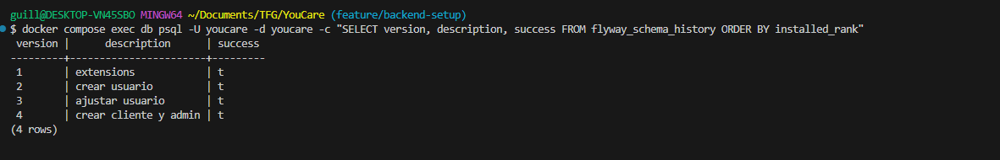
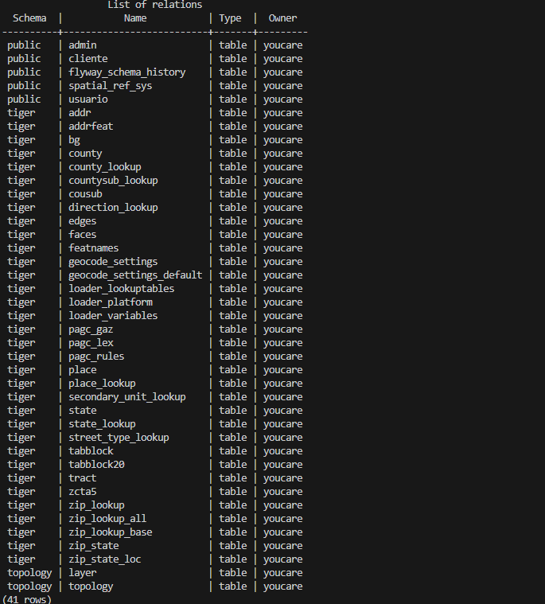
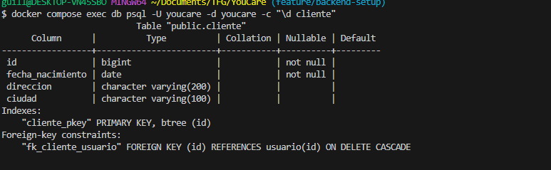
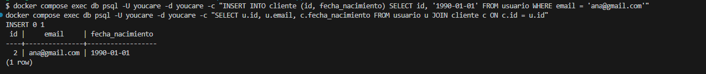

# Comprobaciones de la base de datos — YouCare

Comandos para comprobar desde la terminal que la BD local está como esperamos.
Se ejecutan desde la **raíz del repo** (excepto el arranque de la app, que se lanza desde `backend/`).

**Requisito:** Docker Desktop abierto, con *Engine running*.

> Si `psql` muestra `~` o `(END)` al final, es el paginador: pulsa `q` para salir.

---

## 1. Levantar la BD desde cero

```bash
docker compose down -v
docker compose up -d
docker compose ps
```

**Esperado:** `youcare-db` y `youcare-mailpit` en estado `running` (la BD, además, `healthy`).

⚠️ `down -v` borra todos los datos locales. Al arrancar, Flyway reconstruye la BD desde V1.


---

## 2. Arrancar la app

```bash
cd backend
./mvnw spring-boot:run
```

**Esperado en el log:**
- `Successfully applied 4 migrations to schema "public", now at version v4`
- `Started BackendApplication`

Si aparece `Application run failed`, el motivo está en `Message:` o en `Description:`.


---

## 3. Migraciones aplicadas por Flyway

En otra terminal, desde la raíz:

```bash
docker compose exec db psql -U youcare -d youcare -c "SELECT version, description, success FROM flyway_schema_history ORDER BY installed_rank"
```

**Esperado:** V1, V2, V3 y V4, todas con `success = t`.



---

## 4. Extensiones

```bash
docker compose exec db psql -U youcare -d youcare -c "\dx"
```

**Esperado:** `postgis` y `btree_gist` en la lista.


---

## 5. Tablas

### 5.1 Listado

```bash
docker compose exec db psql -U youcare -d youcare -c "\dt"
```

**Esperado:** `usuario`, `cliente`, `admin`, `flyway_schema_history` y `spatial_ref_sys` (esta última la crea PostGIS).



### 5.2 `usuario`

```bash
docker compose exec db psql -U youcare -d youcare -c "\d usuario"
```

**Esperado:**
- `telefono` y `cantidad_strikes` con `not null`; `cantidad_strikes` con default `0`.
- Restricciones `uk_usuario_email`, `ck_usuario_email_minusculas`, `ck_usuario_rol` y `ck_usuario_strikes`.
- Referenciada por `fk_admin_usuario` y `fk_cliente_usuario`, con `ON DELETE CASCADE`.


### 5.3 `cliente`

```bash
docker compose exec db psql -U youcare -d youcare -c "\d cliente"
```

**Esperado:**
- `id` es la PK.
- `fecha_nacimiento` con `not null`.
- `direccion varchar(200)` y `ciudad varchar(100)`.
- FK `fk_cliente_usuario`.



### 5.4 `admin`

```bash
docker compose exec db psql -U youcare -d youcare -c "\d admin"
```

**Esperado:** `id` es la PK, `departamento varchar(100)` y FK `fk_admin_usuario`.


---

## 6. Las restricciones funcionan

Cada prueba intenta insertar un dato inválido. **El error es el resultado esperado.**

### 6.1 Email en mayúsculas → rechazado

```bash
docker compose exec db psql -U youcare -d youcare -c "INSERT INTO usuario (email, hash_contrasenia, nombre, apellidos, telefono, rol) VALUES ('Ana@gmail.com', 'x', 'Ana', 'López', '600000000', 'CLIENTE')"
```

**Esperado:** `violates check constraint "ck_usuario_email_minusculas"`


### 6.2 Email correcto → se inserta

```bash
docker compose exec db psql -U youcare -d youcare -c "INSERT INTO usuario (email, hash_contrasenia, nombre, apellidos, telefono, rol) VALUES ('ana@gmail.com', 'x', 'Ana', 'López', '600000000', 'CLIENTE')"
```

**Esperado:** `INSERT 0 1`


### 6.3 Email duplicado → rechazado

Repite el comando del 6.2.

**Esperado:** `violates unique constraint "uk_usuario_email"`


### 6.4 Rol inválido → rechazado

```bash
docker compose exec db psql -U youcare -d youcare -c "INSERT INTO usuario (email, hash_contrasenia, nombre, apellidos, telefono, rol) VALUES ('rol@gmail.com', 'x', 'Rol', 'Malo', '600000001', 'SUPERUSER')"
```

**Esperado:** `violates check constraint "ck_usuario_rol"`


### 6.5 Strikes negativos → rechazado

```bash
docker compose exec db psql -U youcare -d youcare -c "UPDATE usuario SET cantidad_strikes = -1 WHERE email = 'ana@gmail.com'"
```

**Esperado:** `violates check constraint "ck_usuario_strikes"`


### 6.6 Teléfono vacío → rechazado

```bash
docker compose exec db psql -U youcare -d youcare -c "INSERT INTO usuario (email, hash_contrasenia, nombre, apellidos, rol) VALUES ('sintel@gmail.com', 'x', 'Sin', 'Teléfono', 'CLIENTE')"
```

**Esperado:** `null value in column "telefono" ... violates not-null constraint`


### 6.7 Cliente sin usuario → rechazado

```bash
docker compose exec db psql -U youcare -d youcare -c "INSERT INTO cliente (id, fecha_nacimiento) VALUES (9999, '1990-01-01')"
```

**Esperado:** `violates foreign key constraint "fk_cliente_usuario"`


### 6.8 Borrado en cascada

Crear la fila de `cliente` para Ana:

```bash
docker compose exec db psql -U youcare -d youcare -c "INSERT INTO cliente (id, fecha_nacimiento) SELECT id, '1990-01-01' FROM usuario WHERE email = 'ana@gmail.com'"
docker compose exec db psql -U youcare -d youcare -c "SELECT u.id, u.email, c.fecha_nacimiento FROM usuario u JOIN cliente c ON c.id = u.id"
```

Borrar el usuario y comprobar que su fila de `cliente` también desaparece:

```bash
docker compose exec db psql -U youcare -d youcare -c "DELETE FROM usuario WHERE email = 'ana@gmail.com'"
docker compose exec db psql -U youcare -d youcare -c "SELECT count(*) FROM cliente"
```

**Esperado:** antes del borrado, una fila con Ana y su fecha de nacimiento; después, `count = 0`.



---

## 7. Limpiar los datos de prueba

```bash
docker compose exec db psql -U youcare -d youcare -c "DELETE FROM usuario"
```

Por el `ON DELETE CASCADE`, también se vacían `cliente` y `admin`.

---

## 8. Consola interactiva (opcional)

```bash
docker compose exec db psql -U youcare -d youcare
```

| Comando | Qué hace |
|---|---|
| `\dt` | Lista las tablas |
| `\d tabla` | Muestra la estructura de una tabla |
| `\dx` | Lista las extensiones |
| `\q` | Sale |